  

  <a href="https://mubeen-3d-portfolio.vercel.app/">Portfolio</a> ·
  <a href="https://www.linkedin.com/in/muhammad-mubeen-javed-571a00343/">LinkedIn</a> ·
  <a href="mailto:m.mubeenjaved2006@gmail.com">Email</a>

### About me

I'm **Mubeen Javed**, a MERN Stack Developer and BS Finance & Technology student at **Information Technology University (ITU), Lahore**. I enjoy creating responsive interfaces, full-stack applications, and engaging digital experiences.

- **Focus:** React, Node.js, Express, MongoDB
- **Also exploring:** Next.js, Python, Django, TypeScript
- **Interested in:** Internships, collaborative projects, and practical web development

### What I do

  
  
  

### Tech stack

**Frontend:** React · JavaScript · HTML · CSS · Bootstrap · Tailwind CSS · Next.js  
**Backend:** Node.js · Express.js · Python · Django  
**Database:** MongoDB · PostgreSQL (learning)  
**Tools:** Git · GitHub · VS Code · Vercel

### Featured projects

### GitHub activity

<!-- ACTIVITY_START -->
<!-- The workflow will insert the activity card after the first successful data fetch. -->
<!-- ACTIVITY_END -->

### Let's connect

[**Explore my portfolio**](https://mubeen-3d-portfolio.vercel.app/) · [**Connect on LinkedIn**](https://www.linkedin.com/in/muhammad-mubeen-javed-571a00343/) · [**Email me**](mailto:m.mubeenjaved2006@gmail.com)
